# Three-Tier Architecture on AWS (VPC + ALB + Auto Scaling + RDS)

A hands-on, fully practical build of a **highly available three-tier web application** on AWS in the **Mumbai region (ap-south-1)**.
The app is a simple **user registration website** (HTML, CSS, PHP, MySQL) with an admin entries page.

> Built by **Vaibhav Sanjay Patil** · [GitHub](https://github.com/vebvp) · [LinkedIn](https://linkedin.com/in/vebvpatil)

---

## 1. Architecture

```
                         Internet
                            │
                  ┌─────────▼─────────┐
                  │  Internet Gateway │
                  └─────────┬─────────┘
                            │
        ┌───────────────────▼───────────────────┐
        │ PUBLIC SUBNETS (1a, 1b)               │
        │ Web ALB (internet-facing)  [WebAlbSG] │
        └───────────────────┬───────────────────┘
                            │ HTTP 80
        ┌───────────────────▼───────────────────┐
        │ WEB TIER – WebSubnet1/2               │
        │ Auto Scaling Group → Nginx            │
        │ index.html, style.css [WebEc2SG]      │
        │ *.php requests → proxy_pass → App ALB │
        └───────────────────┬───────────────────┘
                            │ HTTP 80
        ┌───────────────────▼───────────────────┐
        │ Internal App ALB          [AppAlbSG]  │
        └───────────────────┬───────────────────┘
                            │ HTTP 80
        ┌───────────────────▼───────────────────┐
        │ APP TIER – AppSubnet1/2               │
        │ Auto Scaling Group → Nginx + PHP-FPM  │
        │ db.php, register.php, entries.php     │
        │                           [AppEc2SG]  │
        └───────────────────┬───────────────────┘
                            │ MySQL 3306
        ┌───────────────────▼───────────────────┐
        │ DB TIER – DbSubnet1/2                 │
        │ Amazon RDS MySQL            [DbSG]    │
        └───────────────────────────────────────┘
```

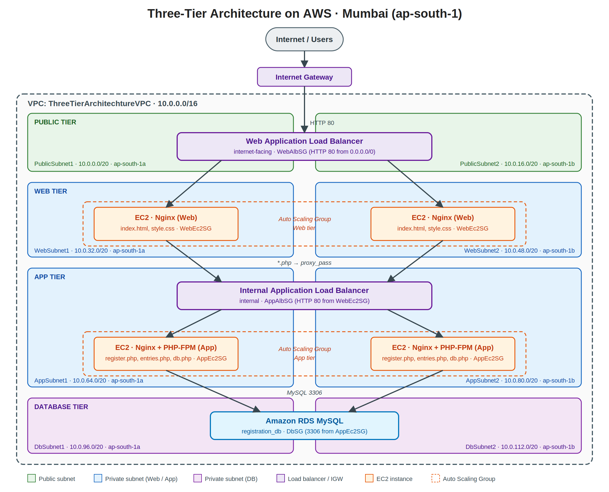

### Services used

| Service | Purpose |
|---|---|
| VPC, Subnets, Route Tables, Internet Gateway | Network isolation |
| Security Groups | Tier-to-tier traffic control |
| EC2 (Amazon Linux, Nginx, PHP-FPM) | Web and app servers |
| AMI + Launch Template | Repeatable server image |
| Target Groups + Application Load Balancers | Traffic distribution |
| Auto Scaling Groups | High availability and scaling |
| RDS (MySQL) | Managed database |

---

## 2. Network plan

**VPC:** `ThreeTierArchitechtureVPC` · CIDR `10.0.0.0/16` · Region `ap-south-1` (Mumbai)

| Subnet | AZ | CIDR | Type |
|---|---|---|---|
| PublicSubnet1 | ap-south-1a | 10.0.0.0/20 | Public |
| PublicSubnet2 | ap-south-1b | 10.0.16.0/20 | Public |
| WebSubnet1 | ap-south-1a | 10.0.32.0/20 | Private |
| WebSubnet2 | ap-south-1b | 10.0.48.0/20 | Private |
| AppSubnet1 | ap-south-1a | 10.0.64.0/20 | Private |
| AppSubnet2 | ap-south-1b | 10.0.80.0/20 | Private |
| DbSubnet1 | ap-south-1a | 10.0.96.0/20 | Private |
| DbSubnet2 | ap-south-1b | 10.0.112.0/20 | Private |

---

## 3. Repository structure

```
three-tier-architecture-aws/
├── README.md
├── screenshots/              # all screenshots used in this guide
├── web-tier/
│   ├── index.html
│   ├── style.css
│   └── nginx-web.conf        # nginx config with the proxy_pass block
├── app-tier/
│   ├── db.php.example        # NO real password – copy to db.php on the server
│   ├── register.php
│   ├── entries.php
│   └── nginx-app.conf
├── database/
│   └── database.sql
└── .gitignore                # ignore db.php, *.pem
```

---

## 4. Step-by-step implementation

> 💡 All screenshots used in this guide are in the `screenshots/` folder (AWS account ID and mobile numbers are hidden).

---

### Step 1 – Create the custom VPC

1. AWS Console → set region to **Asia Pacific (Mumbai) ap-south-1**.
2. Open **VPC** → **Your VPCs** → **Create VPC**.
3. Choose **VPC only**.
4. Name: `ThreeTierArchitechtureVPC`, IPv4 CIDR: `10.0.0.0/16`, No IPv6, Tenancy: Default.
5. Click **Create VPC**.

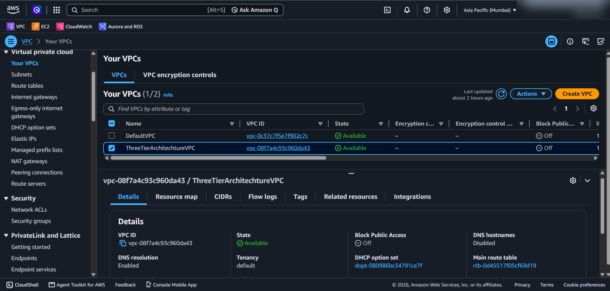

---

### Step 2 – Create the 8 subnets

**VPC → Subnets → Create subnet**, select `ThreeTierArchitechtureVPC`, then add all 8 subnets from the table in Section 2 (you can add several in one go with **Add new subnet**).

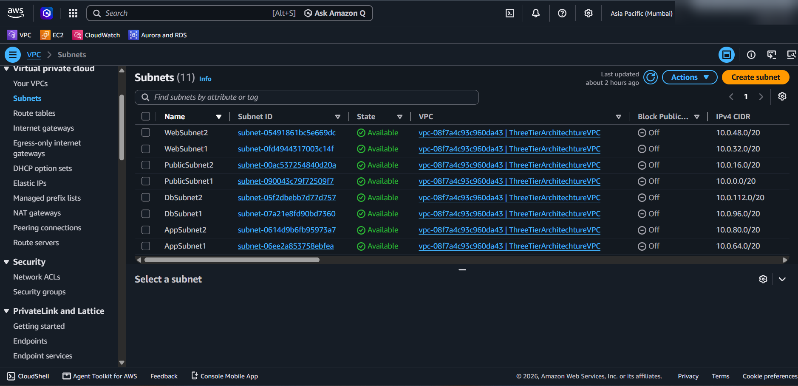

---

### Step 3 – Internet Gateway and route tables

**Internet Gateway**
1. VPC → **Internet gateways** → **Create internet gateway** → name `TTAVPC-InternetGateway`.
2. **Actions → Attach to VPC** → select `ThreeTierArchitechtureVPC`.

**Public route table**
1. **Route tables → Create route table** → name `TTAVPC-PublicRouteTable`, VPC = your VPC.
2. **Routes → Edit routes → Add route**: `0.0.0.0/0` → target `TTAVPC-InternetGateway`.
3. **Subnet associations** → **PublicSubnet1** and **PublicSubnet2** use this table (it is the VPC's *main* route table, so they are associated automatically; you can also associate them explicitly).

**Private route table**
1. Create `TTAVPC-PrivateRouteTable` (only the default `local` route – no internet route).
2. **Subnet associations → Edit** → select the 6 private subnets (Web, App, Db × 2).

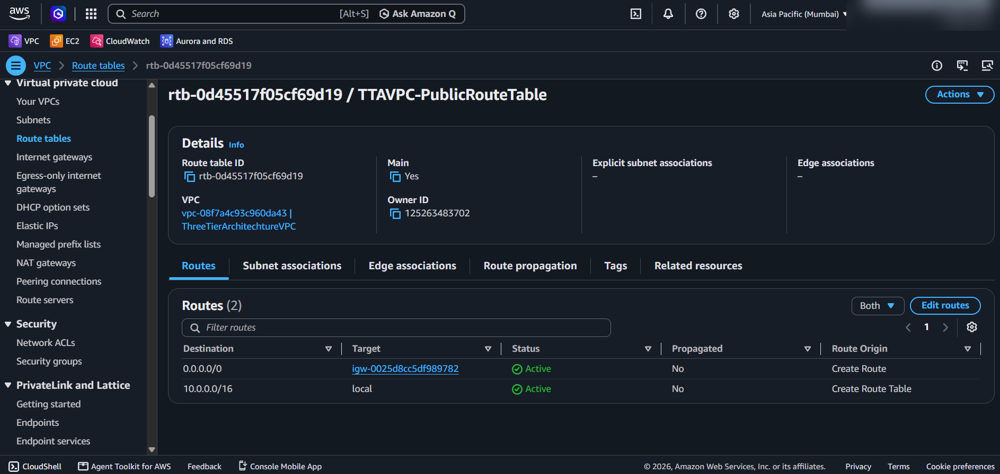

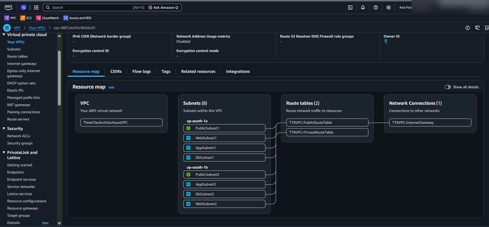

---

### Step 4 – Create the Security Groups

**VPC → Security groups → Create security group** (VPC = `ThreeTierArchitechtureVPC`). Create them in this order, because each one references the previous one.

| # | Name | Inbound rule | Source |
|---|---|---|---|
| 1 | `WebAlbSG` | HTTP 80 | `0.0.0.0/0` |
| 2 | `WebEc2SG` | HTTP 80 | `WebAlbSG` |
| 3 | `AppAlbSG` | HTTP 80 | `WebEc2SG` |
| 4 | `AppEc2SG` | HTTP 80 | `AppAlbSG` |
| 5 | `DbSG` | MySQL/Aurora 3306 | `AppEc2SG` |
| 6 | `DevSG` | SSH 22 and HTTP 80 | My IP |

Description of each group (use in the "Description" field):
- WebAlbSG – Allow HTTP traffic from the internet to the Web Load Balancer
- WebEc2SG – Allow HTTP traffic only from the Internet-facing ALB to Web EC2 instances
- AppAlbSG – Allow HTTP traffic only from Web EC2 instances to the Internal App Load Balancer
- AppEc2SG – Allow HTTP traffic only from the Internal ALB to App EC2 instances
- DbSG – Allow MySQL database traffic only from App EC2 instances to RDS
- DevSG – Allow SSH access from My IP and HTTP access for testing the Development EC2 server

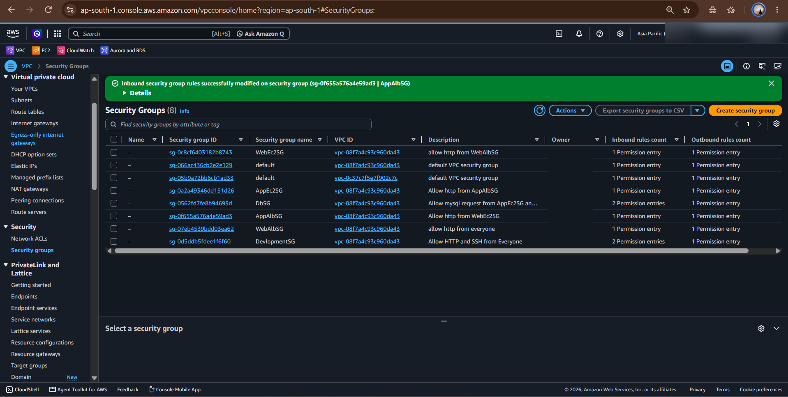

---

### Step 5 – Create the RDS MySQL database

1. **RDS → Subnet groups → Create DB subnet group**: name `tta-db-subnet-group`, VPC = your VPC, AZs = 1a and 1b, subnets = **DbSubnet1** and **DbSubnet2**.
2. **RDS → Databases → Create database**:
   - Standard create → **MySQL** · DB instance identifier: `database-1`
   - Template: **Free tier / Dev-Test**
   - Master username and password (Example : MasterUser- root Pass- pass1234)
   - Connectivity: VPC = your VPC, DB subnet group = `tta-db-subnet-group`, **Public access = No**, Security group = `DbSG`
3. Click **Create database** and wait until the status is **Available**.
4. Copy the **Endpoint** (you need it in `db.php`).

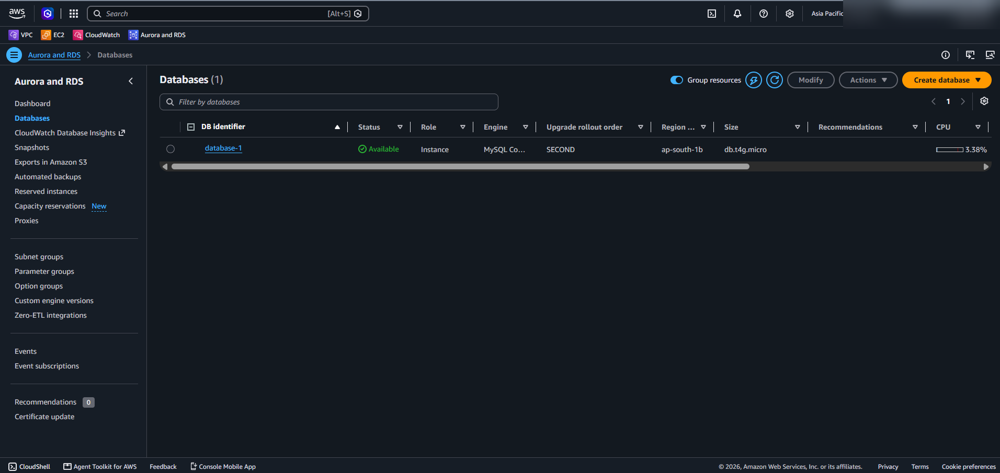

---

### Step 6 – Development EC2: create the database and tables

A temporary "development" server in a public subnet is used to configure RDS and build the AMIs.

1. **EC2 → Launch instance**
   - Name: `dev-ec2`, AMI: **Amazon Linux**, type: `t2.micro` / `t3.micro`
   - Key pair: create/select one
   - Network: your VPC, subnet **PublicSubnet1**, **Auto-assign public IP = Enable**
   - Security groups: `DevSG` **and** `AppEc2SG`
     *(`DbSG` only allows port 3306 from `AppEc2SG`, so the dev server needs `AppEc2SG` to reach RDS.)*
2. SSH in and connect to RDS:

```bash
ssh -i your-key.pem ec2-user@<DEV-EC2-PUBLIC-IP>

sudo dnf install -y mariadb105
mysql -h <RDS-ENDPOINT> -u <master-user> -p
```

3. Create the database and table (see `database/database.sql`):

```sql
CREATE DATABASE registration_db;
USE registration_db;

CREATE TABLE users (
  id INT AUTO_INCREMENT PRIMARY KEY,
  username VARCHAR(100) NOT NULL,
  password VARCHAR(255) NOT NULL,
  mobile VARCHAR(15) NOT NULL,
  created_at TIMESTAMP DEFAULT CURRENT_TIMESTAMP
);
SHOW TABLES;
```

4. `exit` from MySQL and `exit` from the server.

---

### Step 7 – App tier server: install Nginx + PHP and add PHP pages

Launch the development EC2 again (same settings as Step 6) and run:

```bash
sudo dnf update -y
sudo dnf install -y nginx php-fpm php-mysqlnd   # use `dnf search php-fpm` if your AMI needs a versioned name, e.g. php8.2-fpm
```

Let Nginx talk to PHP-FPM (run PHP-FPM as the `nginx` user):

```bash
sudo sed -i 's/^user = apache/user = nginx/;s/^group = apache/group = nginx/' /etc/php-fpm.d/www.conf
sudo sed -i 's/^;listen.owner = .*/listen.owner = nginx/;s/^;listen.group = .*/listen.group = nginx/' /etc/php-fpm.d/www.conf
```

Make sure the Nginx `server` block (in `/etc/nginx/nginx.conf`) can run PHP – see `app-tier/nginx-app.conf`:

```nginx
server {
    listen 80;
    server_name _;
    root /usr/share/nginx/html;
    index index.php;

    location / {
        try_files $uri $uri/ =404;
    }

    location ~ \.php$ {
        include fastcgi_params;
        fastcgi_pass unix:/run/php-fpm/www.sock;
        fastcgi_param SCRIPT_FILENAME $document_root$fastcgi_script_name;
    }
}
```

Start and enable the services:

```bash
sudo nginx -t
sudo systemctl start nginx php-fpm
sudo systemctl enable nginx php-fpm
```

Add the PHP pages to `/usr/share/nginx/html/`:

```bash
cd /usr/share/nginx/html
sudo nano db.php         # RDS endpoint, user, password, registration_db
sudo nano register.php
sudo nano entries.php
```

Quick test from your browser: `http://<DEV-EC2-PUBLIC-IP>/register.php`. Then `exit`.

---

### Step 8 – Create the App-tier AMI

1. EC2 → select the dev instance → **Actions → Image and templates → Create image**.
2. Image name: `app-tier-ami` → **Create image**.
3. Wait until **EC2 → AMIs** shows status **Available**.
4. **Terminate** the development instance.

---

### Step 9 – App-tier Launch Template, Target Group, Internal ALB and Auto Scaling Group

**Launch Template** (EC2 → Launch Templates → Create)
- Name: `app-tier-lt`
- AMI: **My AMIs → `app-tier-ami`**
- Instance type: `t2.micro` / `t3.micro`
- Security group: **AppEc2SG** (do not select a subnet in the template)

**Target Group** (EC2 → Target Groups → Create)
- Type: Instances · Name: `AppTG` · Protocol HTTP : 80 · VPC = your VPC
- Health check path: a PHP page that returns 200 (for example `/register.php`)

**Internal Load Balancer** (EC2 → Load Balancers → Create → Application Load Balancer)
- Name: `AppTierAutoScalingGroup-1` · Scheme: **Internal**
- VPC = your VPC · Subnets: **AppSubnet1** and **AppSubnet2**
- Security group: **AppAlbSG**
- Listener HTTP : 80 → forward to `AppTG`
- Copy the **internal ALB DNS name** – the web tier needs it.

**Auto Scaling Group** (EC2 → Auto Scaling Groups → Create)
- Name: `app-tier-asg` · Launch template: `app-tier-lt`
- VPC = your VPC · Subnets: **AppSubnet1** and **AppSubnet2**
- Attach to existing load balancer → choose `AppTG`, enable ELB health checks
- Desired 2 · Min 2 · Max 4

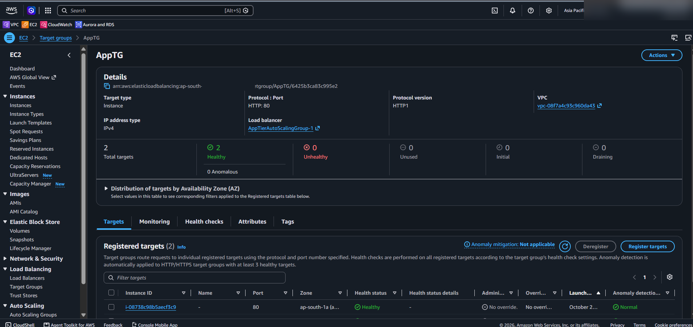

---

### Step 10 – Web tier server: Nginx, index.html, style.css and the PHP proxy

Launch one more development EC2 (PublicSubnet1, `DevSG`) and SSH in:

```bash
sudo dnf update -y
sudo dnf install -y nginx
sudo systemctl start nginx
sudo systemctl enable nginx

cd /usr/share/nginx/html
sudo nano index.html
sudo nano style.css
```

Edit the Nginx config (`sudo nano /etc/nginx/nginx.conf`) and add inside the `server { ... }` block:

```nginx
location ~ \.php$ {
    proxy_pass http://<INTERNAL-APP-ALB-DNS>;
    proxy_set_header Host $host;
    proxy_set_header X-Real-IP $remote_addr;
}
```

> ⚠️ The `proxy_pass` target is the **Internal App Load Balancer DNS** (created in Step 9). Using the Web ALB DNS here would send requests in a loop.

Save, test and reload:

```bash
sudo nginx -t
sudo systemctl reload nginx
exit
```

---

### Step 11 – Web-tier AMI and Launch Template

1. EC2 → dev instance → **Create image** → name `web-tier-ami` → wait until **Available** → **terminate** the dev instance.
2. **Launch Templates → Create**: name `web-tier-lt`, AMI = `web-tier-ami`, instance type `t2.micro`/`t3.micro`, security group **WebEc2SG**.

---

### Step 12 – Web-tier Target Group and Internet-facing Load Balancer

**Target Group:** `WebTG` · HTTP : 80 · health check path `/`

**Load Balancer (Application)**
- Name: `WebLoadBalancer` · Scheme: **Internet-facing** · IPv4
- VPC = your VPC · Subnets: **PublicSubnet1** and **PublicSubnet2**
- Security group: **WebAlbSG**
- Listener HTTP : 80 → forward to `WebTG`

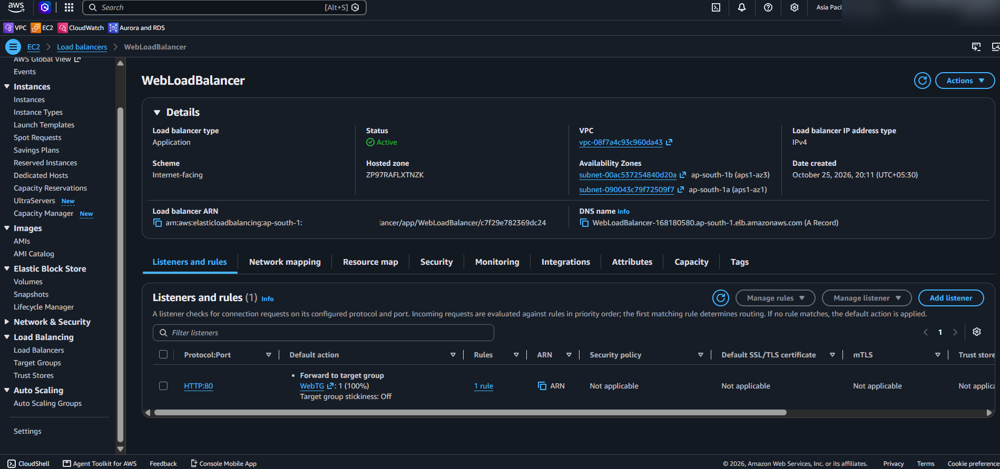

---

### Step 13 – Web-tier Auto Scaling Group

**EC2 → Auto Scaling Groups → Create**
- Name: `web-tier-asg` · Launch template: `web-tier-lt`
- Subnets: **WebSubnet1** and **WebSubnet2**
- Attach to existing load balancer → `WebTG`, enable ELB health checks
- Desired 2 · Min 2 · Max 4

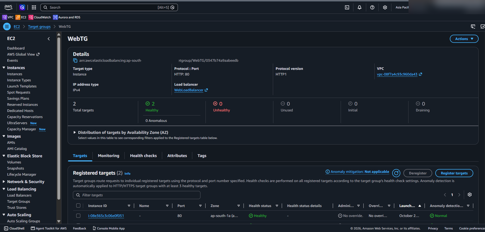

---

### Step 14 – Test the full three-tier application

1. Copy the **DNS name** of `WebLoadBalancer` (EC2 → Load Balancers).
2. Open `http://<WEB-ALB-DNS-NAME>` in your browser → the registration page loads.
3. Submit the registration form → data is stored in RDS.
4. Open `http://<WEB-ALB-DNS-NAME>/entries.php` → the entries appear.

**Extra proof tests (optional but impressive)**
- Terminate one web or app instance → the ASG launches a replacement automatically.
- Refresh the page several times → traffic keeps working through the other AZ.

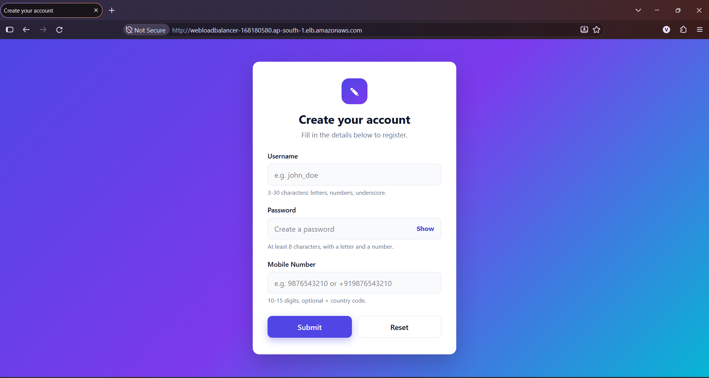

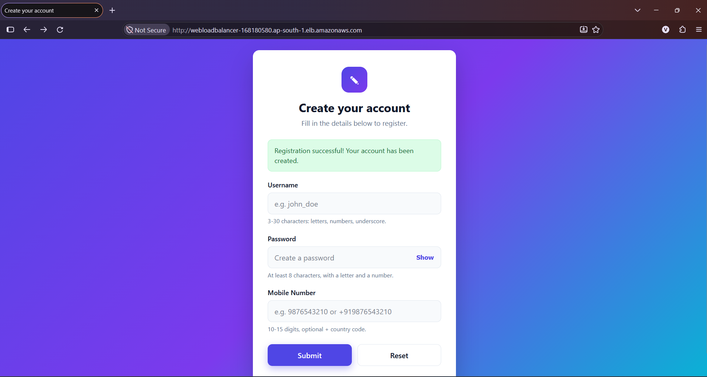

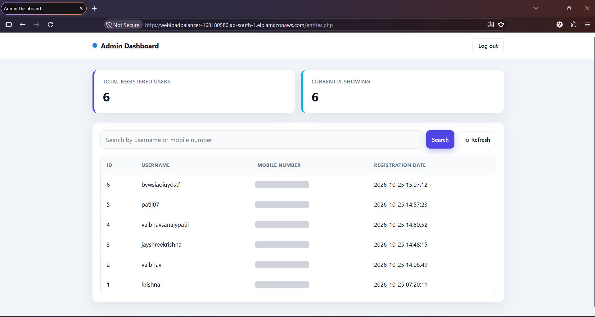

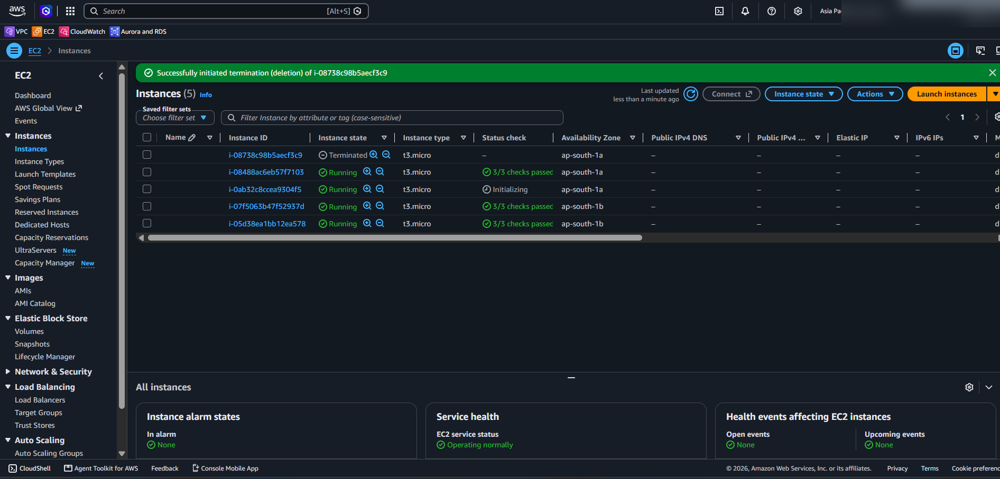

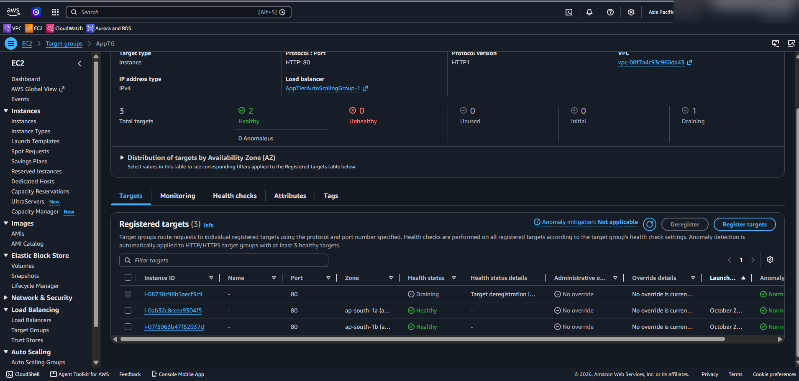

---

## 5. Security design summary

- Only the **Web ALB** is exposed to the internet (port 80).
- Web, app and DB servers live in **private subnets** with no direct internet route.
- Each tier only accepts traffic from the tier directly above it (security group chaining).
- RDS is **not publicly accessible** and accepts MySQL only from `AppEc2SG`.
- SSH is limited to **My IP** on the temporary development server only.

## 6. Clean-up (avoid AWS charges)

Delete in this order: Auto Scaling Groups → Load Balancers → Target Groups → Launch Templates → AMIs and their snapshots → RDS database → Security groups → Route tables / Internet gateway → Subnets → VPC.

## 7. What I learned

- Designing a custom VPC with public and private subnets across two AZs
- Security group chaining between tiers
- Creating AMIs, Launch Templates and Auto Scaling Groups
- Internet-facing vs internal Application Load Balancers
- Connecting a PHP application to Amazon RDS

---

> ⚠️ Never upload `db.php` with the real RDS password or your `.pem` key. Upload `db.php.example` with placeholder values instead.
